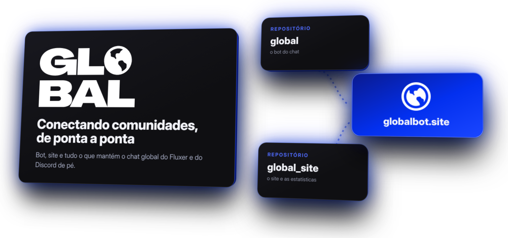
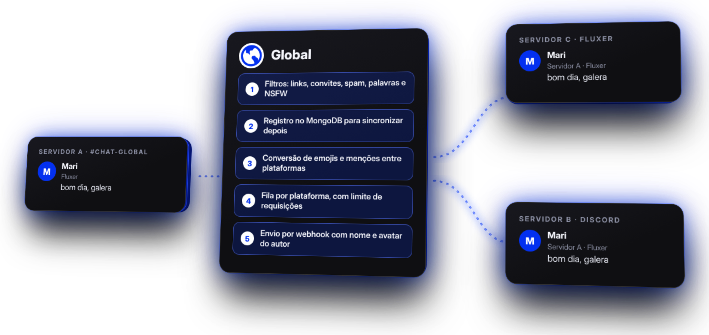
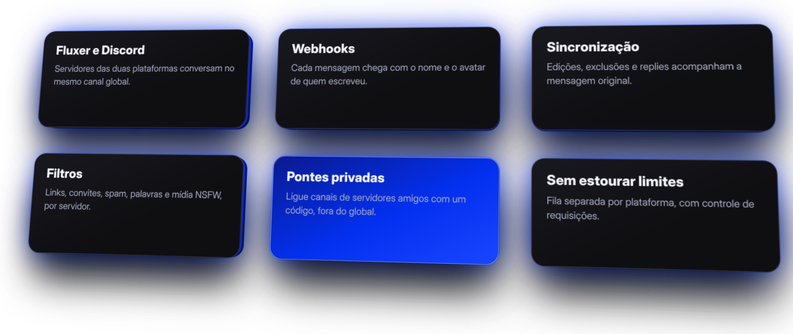
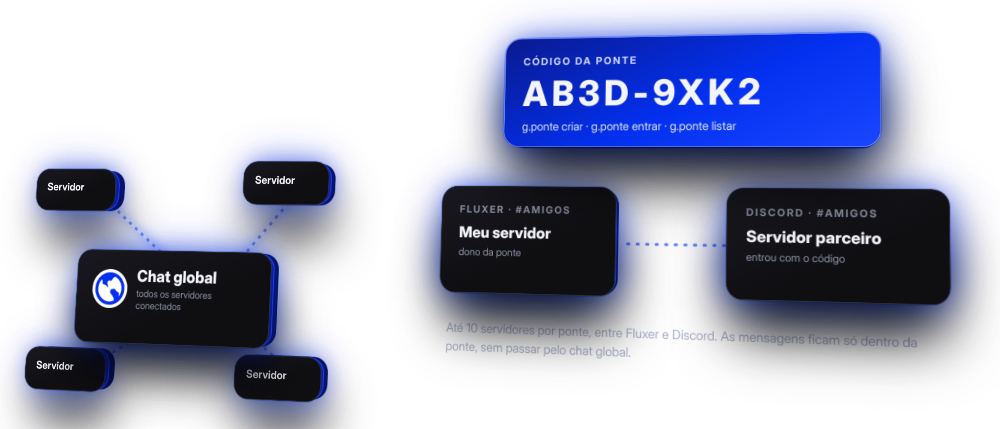

 

 

<h2 align="center">O que é o Global</h2>

O Global é um chat que atravessa servidores. 
Cada comunidade escolhe um canal, e as mensagens aparecem nos canais de todas as outras, 
no <a href="https://fluxer.app">Fluxer</a> e no Discord, com edições, exclusões e replies sincronizados.

 

<h2 align="center">Por que usar</h2>

 

<h2 align="center">Pontes privadas</h2>

Prefere conversar só com servidores amigos? Crie uma ponte com <code>g.ponte criar</code>, 
compartilhe o código e ligue canais do Fluxer e do Discord, fora do chat global.

 

<h2 align="center">Repositórios</h2>

| Repositório | O que tem |
| --- | --- |
| [**global**](https://github.com/globaloficial/global) | O bot: filtros, retransmissão por webhook, sincronização e pontes privadas |
| [**global_site**](https://github.com/globaloficial/global_site) | O site em [globalbot.site](https://globalbot.site), com parceiros e estatísticas em tempo real |

 

<h2 align="center">Tecnologias</h2>

| Parte | Tecnologias |
| --- | --- |
| Bot | JavaScript (Node.js 20+ ou Bun), `@fluxerjs/core`, `discord.js`, Mongoose e MongoDB |
| Site | HTML, CSS e JavaScript puro, hospedado na Vercel |

 

<h2 align="center">Como participar</h2>

Abra uma <b>issue</b> para relatar um problema ou sugerir algo no repositório do <a href="https://github.com/globaloficial/global/issues">bot</a> ou do <a href="https://github.com/globaloficial/global_site/issues">site</a>. 
Quer que a sua comunidade apareça na página de parceiros? Fale com a gente pelo <a href="https://globalbot.site">site</a>.

 

<h2 align="center">Licença</h2>

Os projetos são distribuídos sob a <a href="https://polyformproject.org/licenses/noncommercial/1.0.0/">PolyForm Noncommercial 1.0.0</a>.

 

Criado por xMqR · Apoiado financeiramente por Joao.

